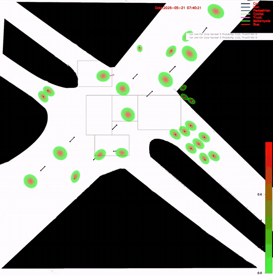
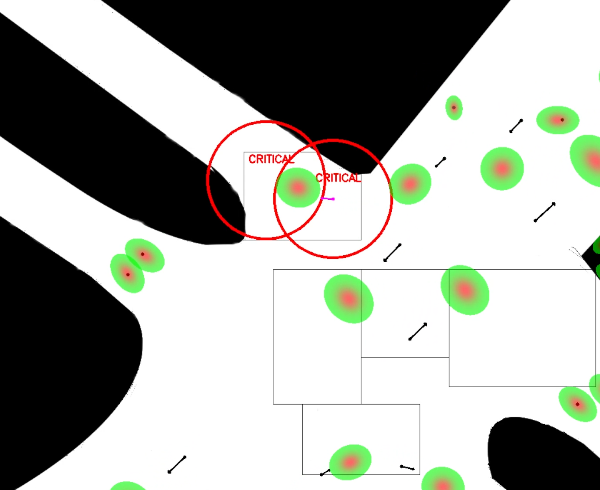

# LiDAR Intersection Trajectory Prediction & Collision Alarm

> **Author:** Mohamad Mofeed Chaar  
> Developed at the **Technical University of Applied Sciences Aschaffenburg**
> (TH Aschaffenburg) as part of the **Urban Mobility** project.

Short-term (1 s) trajectory prediction and probabilistic collision warning for road
users at a signalised intersection, using object lists from a roadside LiDAR sensor.



*`visualization.py` on the sample data (rush hour, 07:40). Full video (3.5 min):
[media/visualization_demo.mp4](media/visualization_demo.mp4)*

**Quick start**

```bash
pip install -r requirements.txt
python visualization.py   # live view of predictions and alarms (display)
python collect_data.py    # process all data and save the alarms to data.csv (collection)
```

See [Usage](#usage) for the difference between the two scripts.

## Project context

This work belongs to the **Urban Mobility** project of the **Technical University of
Applied Sciences Aschaffenburg** (TH Aschaffenburg). LiDAR sensors were installed at a
signalised intersection in Aschaffenburg (intersection K305). The sensors detect and
track all road users – cars, vans, trucks, buses, motorcycles, cyclists and
pedestrians – and publish an object list about 10 times per second.

This repository uses these object lists to predict where every road user will be in
the next second and to detect potentially dangerous situations between them, both as a
live view and as a dataset for later analysis.

## Algorithm

For every LiDAR frame (10 Hz) the pipeline is:

```
object list ──► heading & turn rate ──► CTRV + EKF prediction ──► N(μ, Σ) per object
                                                                     │
           alarm / CSV row ◄── risk level ◄── Monte-Carlo collision simulator (per pair, per zone)
```

### 1. Heading and turn rate

- **Heading ψ** – for moving objects (speed ≥ `motion_min_speed` = 0.5 m/s) the
  direction of the velocity vector, `ψ = atan2(v_y, v_x)`. The bounding-box yaw from the
  sensor is not used for motion: pedestrian boxes are ~90° off the walking direction and
  boxes can flip by 180°. Standing objects keep the box yaw.
- **Turn rate ω** – least-squares slope of the unwrapped heading over the last
  `omega_window_sec` = 0.8 s (only frames where the object moves). The sensor field
  `velocity_angular` is not used: it is derived from the box yaw and jumps to ~31 rad/s
  when the box flips.

### 2. CTRV motion model (Constant Turn Rate and Velocity)

State `x = [p_x, p_y, v, ψ, ω]ᵀ`. Speed and turn rate are assumed constant during the
prediction horizon `Δt = 1 s`:

$$
\begin{aligned}
p_x' &= p_x + \frac{v}{\omega}\big(\sin(\psi + \omega\Delta t) - \sin\psi\big) \\
p_y' &= p_y + \frac{v}{\omega}\big(\cos\psi - \cos(\psi + \omega\Delta t)\big) \\
v' &= v, \qquad \psi' = \psi + \omega\Delta t, \qquad \omega' = \omega
\end{aligned}
$$

For `|ω| < 10⁻³` the straight-line limit is used:
`p_x' = p_x + vΔt cos ψ`, `p_y' = p_y + vΔt sin ψ`.

### 3. Uncertainty propagation (EKF linearisation)

The result of the prediction is a 2-D Gaussian of the future position,
`(p_x, p_y)(t+Δt) ~ N(μ, Σ)`:

$$
\mu = f(x), \qquad
P' = F\,P_0\,F^\top + Q, \qquad
\Sigma = P'_{[0:2,\,0:2]}
$$

- `P₀ = diag(σ_pos², σ_pos², σ_v², σ_ψ², σ_ω²)` – uncertainty of the current state
  (per object class, see below).
- `F = ∂f/∂x` – Jacobian of the CTRV model (analytic, including the limit ω → 0:
  `∂p_x/∂ω = −½ vΔt² sin ψ`, `∂p_y/∂ω = ½ vΔt² cos ψ`).
- `Q = G diag(σ_a², σ_α²) Gᵀ` – process noise from a random longitudinal acceleration
  `a ~ N(0, σ_a²)` and yaw acceleration `α ~ N(0, σ_α²)`, constant over Δt, with
  `ψ_m = ψ + ωΔt/2` (mean heading over the interval):

$$
G = \begin{bmatrix}
\tfrac12\Delta t^2\cos\psi_m & -\tfrac16 v\Delta t^3\sin\psi_m \\
\tfrac12\Delta t^2\sin\psi_m & \tfrac16 v\Delta t^3\cos\psi_m \\
\Delta t & 0 \\
0 & \tfrac12\Delta t^2 \\
0 & \Delta t
\end{bmatrix}
$$

  The second column is the sideways drift caused by a yaw acceleration
  (`v·α·Δt³/6`), which makes the ellipse of fast objects wider across the lane.

**Process-noise estimation** – `σ_a` and `σ_α` are re-estimated every frame from the
tracked history of each object class: differences of speed and turn rate between
samples at least 0.5 s apart (shorter lags measure sensor noise, not motion), robust
standard deviation (1 %/99 % tails removed), then clipped to a per-class range.

**Per-class parameters** (`class_motion` in `config/parameters.py`):

| Class | Model | max \|ω\| [rad/s] | σ_pos [m] | σ_v [m/s] | σ_ψ [rad] | σ_ω [rad/s] | σ_a range [m/s²] | σ_α range [rad/s²] |
|-------|-------|------|-----|-----|------|------|-----------|-----------|
| Car, Van | CTRV | 1.0 | 0.5 | 0.5 | 0.05 | 0.10 | 0.5 – 3.0 | 0.1 – 1.0 |
| Truck, Bus | CTRV | 0.6 | 0.5 | 0.5 | 0.05 | 0.10 | 0.3 – 2.0 | 0.05 – 0.6 |
| Motorcycle | CTRV | 1.0 | 0.5 | 0.5 | 0.08 | 0.15 | 0.5 – 3.0 | 0.1 – 1.0 |
| Cyclist | CTRV | 1.0 | 0.3 | 0.4 | 0.15 | 0.30 | 0.3 – 2.0 | 0.3 – 1.5 |
| Pedestrian | **CV** | 0 | 0.3 | 0.3 | 0.35 | 0.50 | 0.2 – 1.0 | 0.5 – 2.0 |

Pedestrians use a **constant-velocity (CV)** model (ω = 0): they change direction
abruptly and do not drive arcs, so a fitted turn rate only adds error. Their larger
σ_ψ and σ_α make the predicted region wide in all directions.

The predicted Gaussian is drawn on the map as a heat map inside its 99 % region
(`χ²₂ = 9.21`), colour = `exp(−d²/2)` with `d` the Mahalanobis distance.

### 4. Monte-Carlo collision simulator

For every pair of objects (i, j) and every intersection zone:

1. Draw `N` samples from both predicted Gaussians,
   `p_i⁽ᵏ⁾ ~ N(μ_i, Σ_i)`, `p_j⁽ᵏ⁾ ~ N(μ_j, Σ_j)`, `k = 1…N`
   (`N` = `mc_samples_visualization` = 50 or `mc_samples_collect` = 100, fixed seed).
2. Keep sample `k` only if **both** sampled positions lie inside the zone (in pixels).
3. Place each object's **oriented bounding box** (its real length × width, rotated by
   its current heading) at the sampled position and test the two boxes for overlap with
   the **Separating Axis Theorem (SAT)**.
4. Count: `M` = samples in the zone, `C` = samples with overlap.

$$
P_{\text{global}} = \frac{C}{N}, \qquad
P_{\text{zone}} = \frac{C}{M}
$$

`P_global` is the probability that both objects are in the zone **and** collide;
`P_zone` is the probability of collision given that both are in the zone.
A distance-based continuous risk `exp(−d/2)` (d = distance between the sampled
centres) is also averaged over the zone samples (`mean_continuous_risk`,
`max_continuous_risk`).

### 5. Risk level

| Level | Probability |
|-------|-------------|
| SAFE | < 1 % |
| LOW | ≥ 1 % |
| MEDIUM | ≥ 5 % |
| HIGH | ≥ 10 % |
| CRITICAL | ≥ 20 % |

`visualization.py` classifies `P_global`; `collect_data.py` classifies `P_zone` and
saves every pair that is not SAFE.

### 6. Non-motorised pairs are ignored

No collision alarm is reported or saved between two pedestrians, two cyclists, or a
pedestrian and a cyclist. These road users share sidewalks and crossings and pass each
other closely all the time, so overlapping boxes would only produce false alarms.
Every pair that includes a motorised vehicle (Car, Van, Truck, Bus, Motorcycle) is
evaluated, including vehicle–pedestrian and vehicle–cyclist. The ignored classes are
set by `non_motorized` in `visualization.py` / `collect_data.py`.

## Visualization

**Demo video** – 3.5 minutes of `visualization.py` on the sample data in `data/`.
A CRITICAL alarm appears at about 2:29 and 3:04.

<!-- VIDEO: replace the next line with the github.com/user-attachments/assets/... link
     created by dragging media/visualization_demo.mp4 into the GitHub editor -->
[media/visualization_demo.mp4](media/visualization_demo.mp4)



*Example: two road users inside the same zone with a CRITICAL collision risk within
the next second.*

What is drawn in every frame (`visualization.py`):

| Element | Meaning |
|---------|---------|
| Thin black rectangles | Intersection zones in which collisions are evaluated (`zones`) |
| Dot + arrow | Current position of an object; arrow = heading, length ∝ speed; colour = class |
| Green → red ellipse | Predicted position after `Δt = 1 s` (99 % region of `N(μ, Σ)`); red = most likely position, green = edge of the region |
| Coloured circles + label | Collision alarm around **both** objects of a risky pair |
| Text list (right) | The last 5 alarms: classes, zone, probability, time |

The shape of the ellipse shows the uncertainty: fast vehicles get a long ellipse along
the direction of travel (unknown acceleration) and a wider one in curves (unknown turn
rate); pedestrians get a rounder region because they can change direction at any time.

**Alarm levels** – the circle size and colour show the risk level of the pair:

| Level | Collision probability | Circle radius | Colour |
|-------|----------------------|---------------|--------|
| LOW | 1 – 5 % | 25 px | green |
| MEDIUM | 5 – 10 % | 50 px | yellow |
| HIGH | 10 – 20 % | 75 px | orange |
| CRITICAL | ≥ 20 % | 100 px | red |

Pairs below 1 % are SAFE and not drawn. In the example both predicted ellipses overlap
inside the same zone, so most Monte-Carlo samples give overlapping boxes and the pair is
marked CRITICAL.

## Project structure

| File | Purpose |
|------|---------|
| `visualization.py` | **Live view** – reads the data, predicts, detects risks and shows them on the intersection map |
| `collect_data.py` | **Data collection** – same pipeline without display; writes every alarm to `data.csv` |
| `trajectory.py` | CTRV + EKF Gaussian prediction, process-noise estimation |
| `collision_predict.py` | Monte-Carlo collision probability per zone |
| `drow_gaussian.py` | Draws the predicted Gaussian (99 % region) on the image |
| `proccess.py` | Coordinate conversion (1 m = 16 px, image 1600×1600) and drawing helpers |
| `config/parameters.py` | Zones, colours, Δt, per-class motion parameters, data path |
| `drow_points.py` | Utility: accumulate all detections on one image |
| `intersection_area.ipynb` | Notebook used to define the intersection zones |
| `sample/305_rev.png` | Background map of the intersection |
| `k305_objectlist_*.json` | Example input frame |

## Installation

```bash
python -m venv .venv
source .venv/bin/activate
pip install -r requirements.txt
```

## Usage

The project has **two run files**. Both use the same pipeline (heading, CTRV
prediction, Monte-Carlo collision simulator) on the same data; they differ only in
what they do with the result:

| Script | Purpose | Output | Speed |
|--------|---------|--------|-------|
| `visualization.py` | **Display** – watch the traffic, the predictions and the alarms live on the intersection map | OpenCV window (nothing is saved) | ~2 frames/s (waits 0.5 s per frame) |
| `collect_data.py` | **Data collection** – process whole recordings without a window and store every alarm for later analysis | `data.csv` | as fast as possible |

Use `visualization.py` to understand and check the behaviour on a few minutes of data,
and `collect_data.py` to build a dataset of risky situations from hours or days of
recordings (statistics, evaluation, training data, ...).

The `data/` folder contains a sample: 20 minutes of morning rush hour
(2026-05-21, 07:40–08:00, 4 files × 5 min, ~3000 frames each, all object classes),
so both scripts can be run directly after installation.

### Run the live view – `visualization.py`

```bash
python visualization.py
```

- Shows one frame every 0.5 s (see *Visualization* above for what is drawn).
- Press `q` in the window to stop.
- Alarms are also printed in the terminal, one line per alarm.
- Uses the zones `zones` and `mc_samples_visualization` = 50 samples per pair.
- The risk level is classified from `P_global`.

### Collect data – `collect_data.py`

```bash
python collect_data.py
```

- Runs through **all** JSON files of the data folder without opening a window
  (a progress bar shows the files).
- For every frame, every zone and every pair of objects that is not SAFE, one row is
  appended to `data.csv`.
- Each row is **written to disk immediately** (flush + fsync): if the run is stopped
  (Ctrl+C, crash, power loss) the file contains everything up to that moment. At the
  end the number of saved rows is printed.
- Uses the zones `collect_zones` and `mc_samples_collect` = 100 samples per pair.
- The risk level is classified from `P_zone` (collision probability given that both
  objects are inside the zone).
- `data.csv` is overwritten at every start; use `LIDAR_OUTPUT_CSV` (below) to keep
  results of several runs.

#### CSV columns

All positions, velocities, angles, the predicted mean `μ` and covariance `Σ` are stored
in the **original sensor frame**. Output file: `data.csv` (or `LIDAR_OUTPUT_CSV`).
Options: `collect_zones`, `mc_samples_collect`.

**Per object** (`object_1_*`, `object_2_*`):

| Column | Meaning |
|--------|---------|
| `type`, `id` | class and track id |
| `x`, `y` | current position [m] |
| `yaw` | heading used by the model (velocity direction when moving) [rad] |
| `box_yaw` | bounding-box yaw from the sensor [rad] |
| `speed`, `vx`, `vy` | speed and velocity components [m/s] |
| `omega` | measured turn rate [rad/s] (before the per-class clip) |
| `is_moving` | 1 if speed ≥ `motion_min_speed` |
| `width`, `height` | box width and length [m] |
| `mu_x`, `mu_y` | predicted position after `delta_t` [m] |
| `sigma_xx`, `sigma_xy`, `sigma_yy` | predicted position covariance [m²] |
| `sigma_a`, `sigma_alpha` | process noise used (acceleration, yaw acceleration) |
| `track_frames` | frames the object has been tracked (small = new track, less reliable) |

**Per pair:**

| Column | Meaning |
|--------|---------|
| `collision_probability_global` | collisions / all Monte-Carlo samples |
| `collision_probability_given_region` | collisions / samples with both objects inside the zone |
| `risk_level` | `LOW`, `MEDIUM`, `HIGH`, `CRITICAL` (from the probability given the zone) |
| `area_number` | zone index (1-based) |
| `distance` | current centre distance [m] |
| `mean_continuous_risk`, `max_continuous_risk` | distance-based risk `exp(-d/2)` over the samples |
| `num_samples`, `num_region_samples`, `num_collision_samples` | Monte-Carlo counts |
| `time_stamp`, `nanosec`, `time_sec` | frame time (seconds, nanoseconds, combined) |
| `delta_t` | prediction horizon [s] |
| `source_file` | JSON file the frame came from |

Pedestrian–pedestrian, cyclist–cyclist and pedestrian–cyclist pairs are not saved (see *Algorithm*, section 6).

### Changing the data path

All paths are **relative to the project root** (the folder that contains `config/`), so
the scripts work from any working directory. Absolute paths are accepted as well.
The program reads **every `*.json` file** in the data folder (not sub-folders), sorted
by name, i.e. in time order.

| Setting | Default | Environment variable |
|---------|---------|----------------------|
| Input JSON folder | `data` | `LIDAR_DATA_PATH` |
| Output CSV of `collect_data.py` | `data.csv` | `LIDAR_OUTPUT_CSV` |

**Option 1 – environment variable (no code change):**

```bash
# only for this command
LIDAR_DATA_PATH=data/2026-05-21 python collect_data.py

# for the whole terminal session (Linux / macOS)
export LIDAR_DATA_PATH=data/2026-05-21
export LIDAR_OUTPUT_CSV=results/alarms_2026-05-21.csv
python collect_data.py
```

Windows (PowerShell):

```powershell
$env:LIDAR_DATA_PATH = "data\2026-05-21"
python collect_data.py
```

**Option 2 – change the default** in `config/parameters.py` → `DataConfig`:

```python
self.data_path  = project_path(os.environ.get('LIDAR_DATA_PATH', 'data/2026-05-21'))
self.output_csv = project_path(os.environ.get('LIDAR_OUTPUT_CSV', 'results/alarms.csv'))
```

The folder of the output CSV must exist. At start the program prints
`Number of files N`; `N = 0` means the path is wrong or contains no `.json` files.

### Options

Useful options in `config/parameters.py`:

| Option | Used by | Meaning |
|--------|---------|---------|
| `zones` | visualization | zones drawn and evaluated in the live view (pixels `x1, y1, x2, y2`) |
| `collect_zones` | collect_data | zones evaluated during data collection |
| `delta_t` | both | prediction horizon [s] |
| `max_frames` | visualization | stop after N frames (`None` = all) |
| `mc_samples_visualization` / `mc_samples_collect` | both | Monte-Carlo samples per pair and zone |
| `motion_min_speed`, `omega_window_sec` | both | heading / turn-rate estimation |
| `class_motion` | both | motion model and noise per object class |

## Input data format

The data are the object lists published by the LiDAR system at intersection K305.
Every object is one tracked road user with a 3-D bounding box, a velocity and a class
label. All coordinates are in metres in the **sensor frame** (origin = reference point of the
LiDAR system near the intersection centre, x/y horizontal, z up); angles in radians; time in UTC epoch
seconds.

### 5-minute files (`data/*.json`)

File name: `k305_object_list_<date>_<HH-MM>_to_<HH-MM>.json` – one file contains
5 minutes, i.e. about **3000 frames** (10 Hz, Δt ≈ 0.1 s).

```json
{
  "intersection_id": "k305",
  "topic": "object_list",
  "aggregation_minutes": 5,
  "aggregation_start_local": "2026-05-21T07:40:00+02:00",
  "frames": [
    {
      "frame_timestamp": { "seconds": 1779342000, "nanosec": 99919856 },
      "timestamp_local": "2026-05-21T07:40:00.099920+02:00",
      "objects": [
        {
          "track_id": 27676,
          "class_name": "Car",
          "score": 1.0,
          "bounding_box": {
            "position": { "x": -15.96, "y": -30.76, "z": -1.77 },
            "yaw": -2.149,
            "scale":    { "x": 4.21, "y": 1.71, "z": 1.53 }
          },
          "velocity": { "x": 0.0, "y": 0.0 }
        }
      ]
    }
  ]
}
```

**File level**

| Field | Meaning |
|-------|---------|
| `intersection_id` | intersection / sensor site (`k305`) |
| `topic` | data stream (`object_list`) |
| `aggregation_minutes` | length of the file (5 min) |
| `aggregation_start_local` | start time of the file, local time with UTC offset |
| `frames` | list of frames in time order |

**Frame level**

| Field | Meaning |
|-------|---------|
| `frame_timestamp.seconds` | UTC epoch time, whole seconds |
| `frame_timestamp.nanosec` | nanoseconds part (time = `seconds + nanosec·10⁻⁹`) |
| `timestamp_local` | the same time as local ISO-8601 string |
| `objects` | all objects detected in this frame (may be empty) |

**Object level**

| Field | Unit | Meaning |
|-------|------|---------|
| `track_id` | – | ID of the track; stays the same while the sensor follows the object, so it links the object across frames (and across files) |
| `class_name` | – | class label, see below |
| `score` | 0–1 | detection confidence (1.0 in the sample data) |
| `bounding_box.position.x/y/z` | m | centre of the 3-D box |
| `bounding_box.yaw` | rad | orientation of the box around the vertical axis (direction of `scale.x`); may be ~90° off for pedestrians and flip by 180° – the code therefore uses the velocity direction as heading |
| `bounding_box.scale.x` | m | box **length** (along `yaw`) |
| `bounding_box.scale.y` | m | box **width** |
| `bounding_box.scale.z` | m | box height |
| `velocity.x/y` | m/s | velocity over ground; speed = `√(x² + y²)` |

### Class labels

| `class_name` | Road user | Typical size L × W × H (median, sample) | Motion model | Counts in sample* |
|--------------|-----------|---------------------------|--------------|-------------------|
| `Car` | passenger car | 4.3 × 1.7 × 1.5 m | CTRV | 51 306 |
| `Van` | van / small transporter | 5.4 × 2.0 × 2.3 m | CTRV | 4 384 |
| `Truck` | truck | 6.9 × 2.3 × 2.8 m | CTRV (heavy) | 3 837 |
| `Bus` | bus | 11.8 × 2.6 × 3.1 m | CTRV (heavy) | 225 |
| `Motorcycle` | motorcycle / scooter | 2.1 × 0.8 × 1.7 m | CTRV | 278 |
| `Cyclist` | bicycle with rider | 1.8 × 0.7 × 1.7 m | CTRV | 7 921 |
| `Pedestrian` | person on foot | 0.7 × 0.6 × 1.7 m | CV | 10 677 |

\* object detections in the first sample file (07:40–07:45, 3000 frames, 1655 different
track IDs). `Pedestrian` and `Cyclist` are the *non-motorised* classes (see
*Algorithm*, section 6). Each class has its own colour in the live view and its own
motion parameters (`colors` and `class_motion` in `config/parameters.py`).

### One-frame-per-file format (older recordings)

Older recordings store one frame per file with flat field names, e.g.
`k305_objectlist_2025-12-11T13-21-11.600409+01-00.json` in the project root. Both
formats are read by the same code (`normalize_object_detect`); the fields map as
follows:

| One-frame format | 5-minute format |
|------------------|-----------------|
| `obj_id` | `track_id` |
| `obj_type` | `class_name` |
| `position_x/y/z` | `bounding_box.position.x/y/z` |
| `scale_x/y/z` | `bounding_box.scale.x/y/z` |
| `rotation_z` | `bounding_box.yaw` |
| `velocity_x/y` | `velocity.x/y` |
| `velocity_magnitude` | computed from `velocity.x/y` |
| `velocity_angular` | not used (turn rate is estimated from the heading history) |

Only objects whose position lies inside the map image (±50 m around the origin) are
used.

## Coordinate frame

Internally `x = position_y`, `y = position_x` and `yaw = π/2 − heading`;
pixel = `800 + 16 · metres`.

## License

<!-- TODO -->
